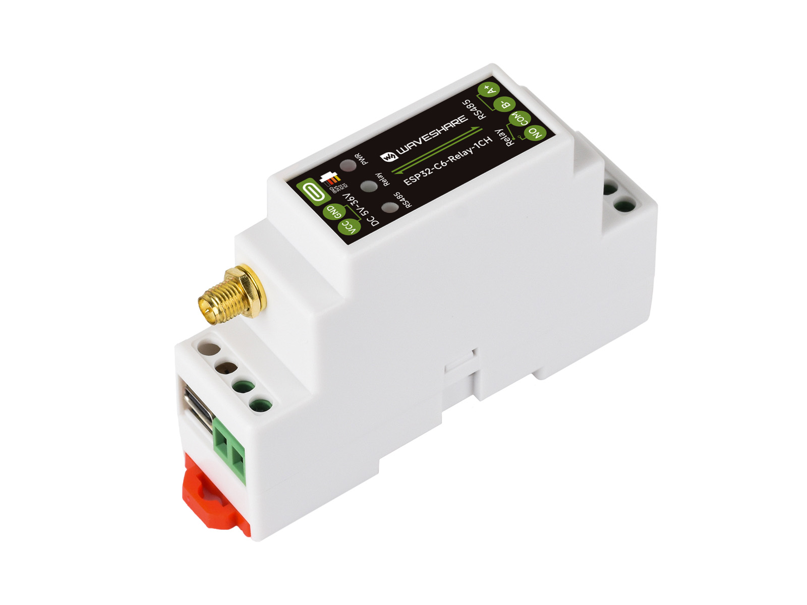

  <h1>ESP32-C6-Relay-1CH-U</h1>
  
<strong>ESP32-C6 single-channel relay module with isolated RS485</strong>

  
<strong>English</strong> | <a href="README_ZH.md">简体中文</a>

  

    
    
    
  

  

    <a href="https://www.waveshare.com/esp32-c6-relay-1ch-u.htm">🛒 Product</a> &middot;
    <a href="firmware/">📦 Firmware</a> &middot;
    <a href="examples/esp-idf/">🧩 ESP-IDF</a> &middot;
    <a href="examples/arduino/examples/">🔧 Arduino</a> &middot;
    <a href="https://www.waveshare.com/wiki/ESP32-C6-Relay-1CH-U">📖 Documentation</a>
  

  

---

## ✨ Overview

A DIN-rail relay module with an RTC and USB Type-C for programming. This repository provides ESP-IDF and Arduino examples.

| Feature | Device / interface |
| --- | --- |
| MCU | ESP32-C6 |
| Flash / PSRAM | 4 MB, 8 MB or 16 MB Flash depending on the module variant, no PSRAM |
| Wireless | 2.4 GHz Wi-Fi 6, Bluetooth LE |
| Relay | 1 normally open channel |
| Interfaces | Isolated RS485, USB Type-C |
| RTC | PCF85063 |

## 📦 Quick Start

1. Build the [ESP-IDF relay demo](examples/esp-idf/ESP32-C6-Relay-1CH-U/) or download an example package from the [latest release](https://github.com/waveshareteam/ESP32-C6-Relay-1CH-U/releases/latest) when available.
2. For a single merged BIN, connect the matching board by USB and follow the [firmware flashing instructions](firmware/). For a release package, use its included flashing script.

## 🧪 Examples

### ESP-IDF

| Example | Main feature |
| --- | --- |
| [ESP32-C6-Relay-1CH-U](examples/esp-idf/ESP32-C6-Relay-1CH-U/) | Relay web demo with Wi-Fi AP and STA modes |

### Arduino

| Example | Main feature |
| --- | --- |
| [MAIN_ALL](examples/arduino/examples/MAIN_ALL/) | Wi-Fi STA web control and MQTT |
| [MAIN_WIFI_AP](examples/arduino/examples/MAIN_WIFI_AP/) | Wi-Fi AP web control |
| [MAIN_WIFI_MQTT](examples/arduino/examples/MAIN_WIFI_MQTT/) | MQTT control over Wi-Fi STA |
| [MAIN_WIFI_STA](examples/arduino/examples/MAIN_WIFI_STA/) | Wi-Fi STA web control |

Bundled libraries are in [`examples/arduino/libraries`](examples/arduino/libraries/).

## 🛠️ Development Environment

| Framework | Version | Examples |
| --- | --- | ---: |
| ESP-IDF | `v6.1` | 1 |
| Arduino-ESP32 | `4.0.0` | 4 |

## 📚 Resources

- [Module datasheet](https://documentation.espressif.com/esp32-c6-wroom-1_wroom-1u_datasheet_en.pdf)
- [Product page](https://www.waveshare.com/esp32-c6-relay-1ch-u.htm)
- [Documentation](https://www.waveshare.com/wiki/ESP32-C6-Relay-1CH-U)

## 🤝 Support

- [Open a GitHub issue](https://github.com/waveshareteam/ESP32-C6-Relay-1CH-U/issues/new/choose) for examples or repository questions.
- [Waveshare support](https://service.waveshare.com/) for hardware and orders.

## 📄 License

Apache License 2.0. See [LICENSE](LICENSE).
