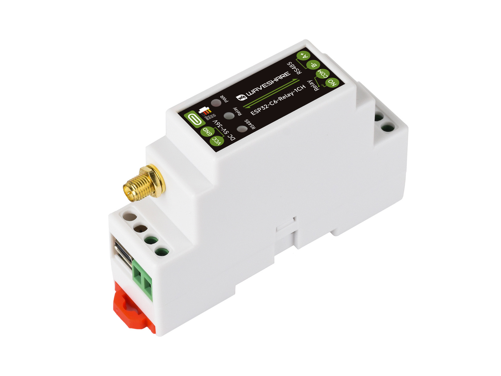

  <h1>ESP32-C6-Relay-1CH-U</h1>
  
<strong>带隔离 RS485 的 ESP32-C6 单路继电器模块</strong>

  
<a href="README.md">English</a> | <strong>简体中文</strong>

  

    
    
    
  

  

    <a href="https://www.waveshare.com/esp32-c6-relay-1ch-u.htm">🛒 产品</a> &middot;
    <a href="firmware/README_ZH.md">📦 固件</a> &middot;
    <a href="examples/esp-idf/">🧩 ESP-IDF</a> &middot;
    <a href="examples/arduino/examples/">🔧 Arduino</a> &middot;
    <a href="https://docs.waveshare.net/ESP32-C6-Relay-1CH-U/">📖 文档</a>
  

  

---

## ✨ 概述

模块采用导轨式外壳，板载 RTC，可通过 USB Type-C 下载程序。仓库提供 ESP-IDF 和 Arduino 示例。

| 功能 | 器件或接口 |
| --- | --- |
| MCU | ESP32-C6 |
| Flash / PSRAM | Flash 随模组版本为 4 MB、8 MB 或 16 MB，无 PSRAM |
| 无线通信 | 2.4 GHz Wi-Fi 6，低功耗蓝牙 |
| 继电器 | 1 路常开触点 |
| 接口 | 隔离 RS485、USB Type-C |
| RTC | PCF85063 |

## 📦 快速开始

1. 编译 [ESP-IDF 继电器示例](examples/esp-idf/ESP32-C6-Relay-1CH-U/README_ZH.md)，或在发布后从[最新版本](https://github.com/waveshareteam/ESP32-C6-Relay-1CH-U/releases/latest)下载示例固件包。
2. 通过 USB 连接对应型号。单个合并 BIN 按[固件烧录说明](firmware/README_ZH.md)操作，发布包使用自带烧录脚本。

## 🧪 示例

### ESP-IDF

| 示例 | 主要功能 |
| --- | --- |
| [ESP32-C6-Relay-1CH-U](examples/esp-idf/ESP32-C6-Relay-1CH-U/README_ZH.md) | 支持 Wi-Fi AP 和 STA 模式的继电器网页示例 |

### Arduino

| 示例 | 主要功能 |
| --- | --- |
| [MAIN_ALL](examples/arduino/examples/MAIN_ALL/README_ZH.md) | Wi-Fi STA 网页控制与 MQTT |
| [MAIN_WIFI_AP](examples/arduino/examples/MAIN_WIFI_AP/README_ZH.md) | Wi-Fi AP 网页控制 |
| [MAIN_WIFI_MQTT](examples/arduino/examples/MAIN_WIFI_MQTT/README_ZH.md) | Wi-Fi STA 下的 MQTT 控制 |
| [MAIN_WIFI_STA](examples/arduino/examples/MAIN_WIFI_STA/README_ZH.md) | Wi-Fi STA 网页控制 |

草图库位于 [`examples/arduino/libraries`](examples/arduino/libraries/)。

## 🛠️ 开发环境

| 开发框架 | 版本 | 示例数 |
| --- | --- | ---: |
| ESP-IDF | `v6.1` | 1 |
| Arduino-ESP32 | `4.0.0` | 4 |

## 📚 资料

- [模组数据手册](https://documentation.espressif.com/esp32-c6-wroom-1_wroom-1u_datasheet_en.pdf)
- [产品页](https://www.waveshare.com/esp32-c6-relay-1ch-u.htm)
- [文档](https://docs.waveshare.net/ESP32-C6-Relay-1CH-U/)

## 🤝 支持

- [微雪技术支持](https://docs.waveshare.net/support/)

## 📄 许可证

Apache License 2.0，详见 [LICENSE](LICENSE)。
